# Creating the cloud environment ([SETUP.md](../../SETUP.md) step 4), click by click

Recorded on claude.ai/code on 2026-11-18. The red box in each screenshot is what to click or fill; a dashed yellow box means "leave as is".

1. Open https://claude.ai/code. Below the prompt box, click the **environment button** (a cloud icon followed by your current environment's name).
   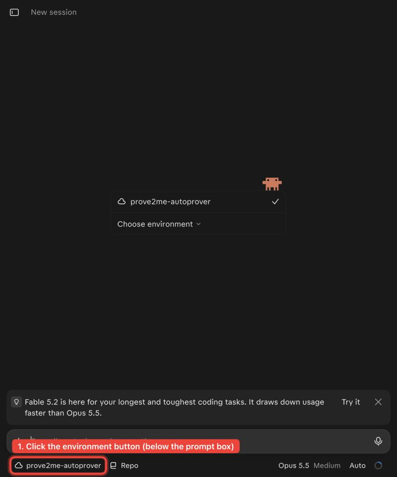
2. In the menu, click **+ New environment**.
   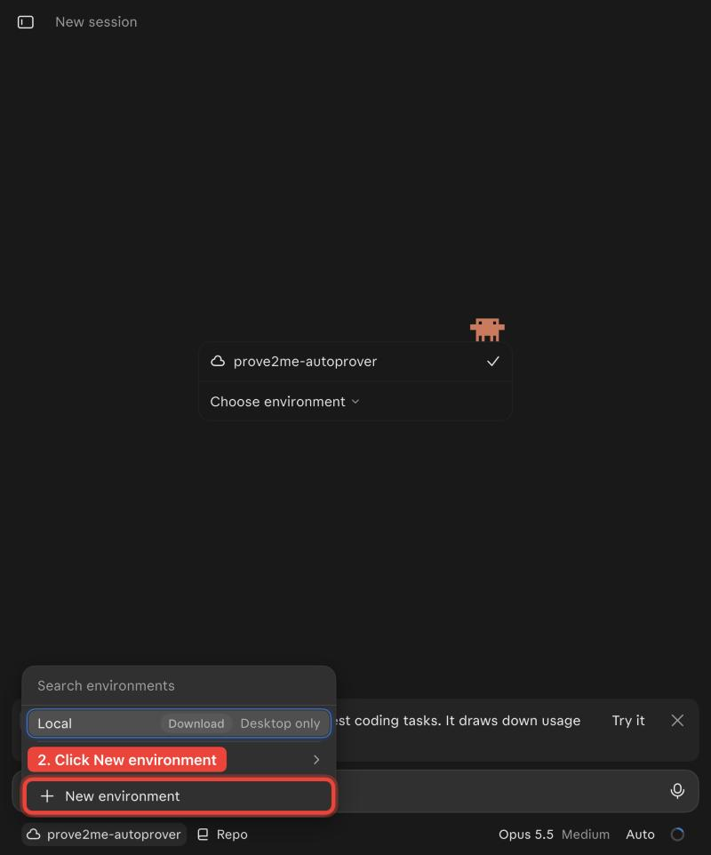
3. In the **Cloud** tab, type the name: `prove2me-at-weekly-reset`.
   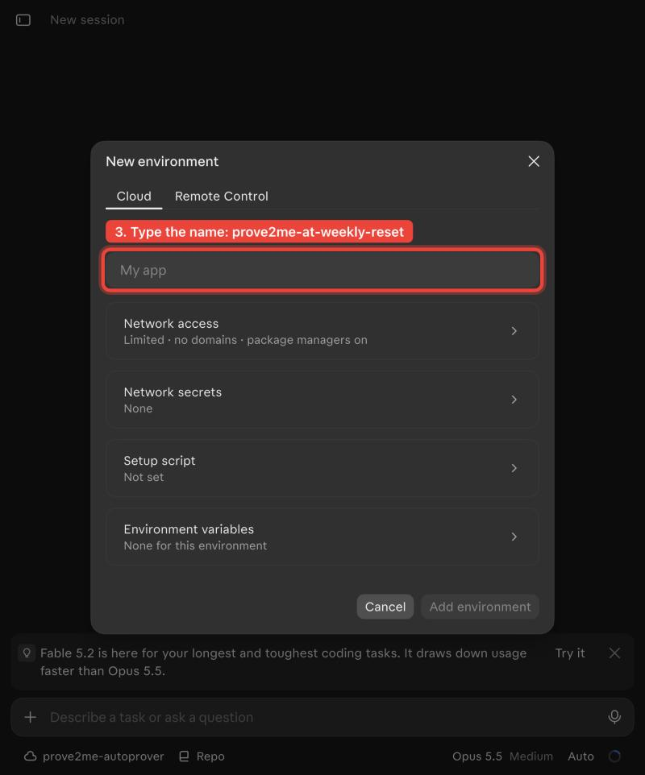
4. Click **Network access**.
   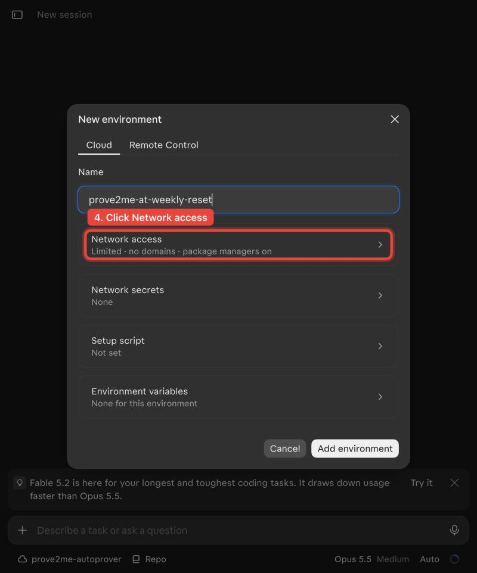
5. Leave the dropdown on **Limited**. In **Allowed domains**, paste:
   ```
   prove2.me
   lakecache.blob.core.windows.net
   *.lean-lang.org
   release-assets.githubusercontent.com
   objects.githubusercontent.com
   ```
   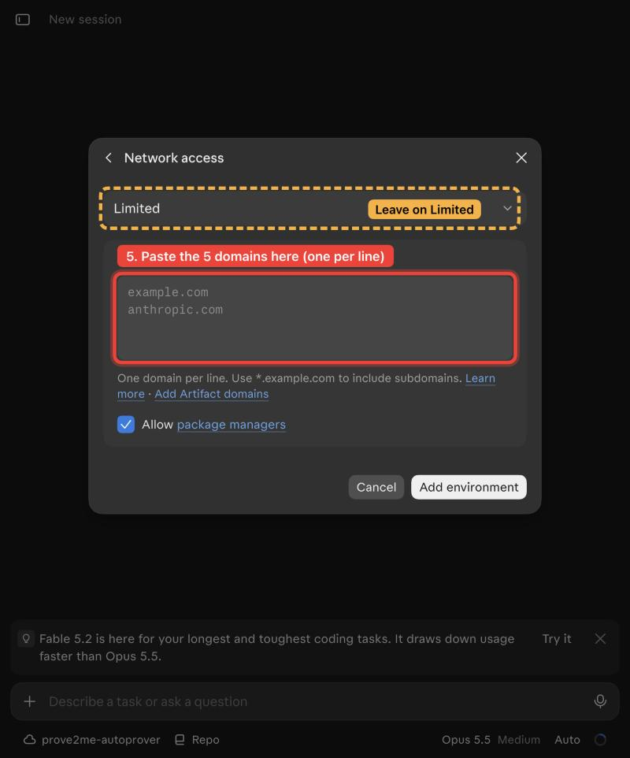
6. Keep **Allow package managers** ticked, then click the **back arrow** (top left).
   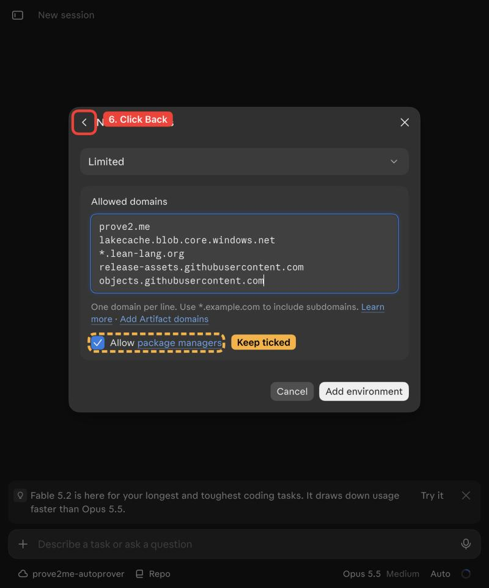
7. Click **Setup script**.
   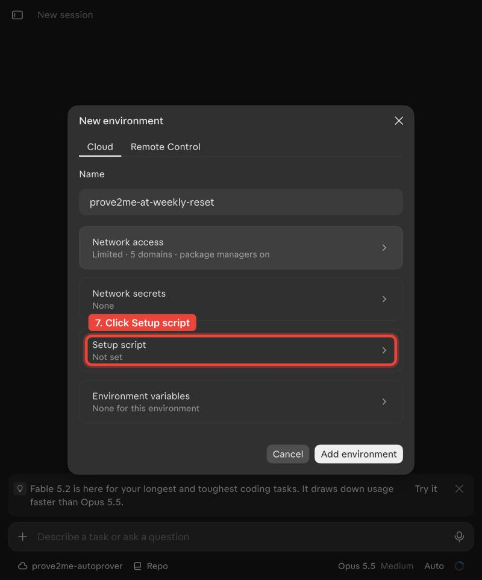
8. Click in the editor and paste the whole of [`scripts/setup.sh`](../../scripts/setup.sh) (or use **Choose file** and pick it).
   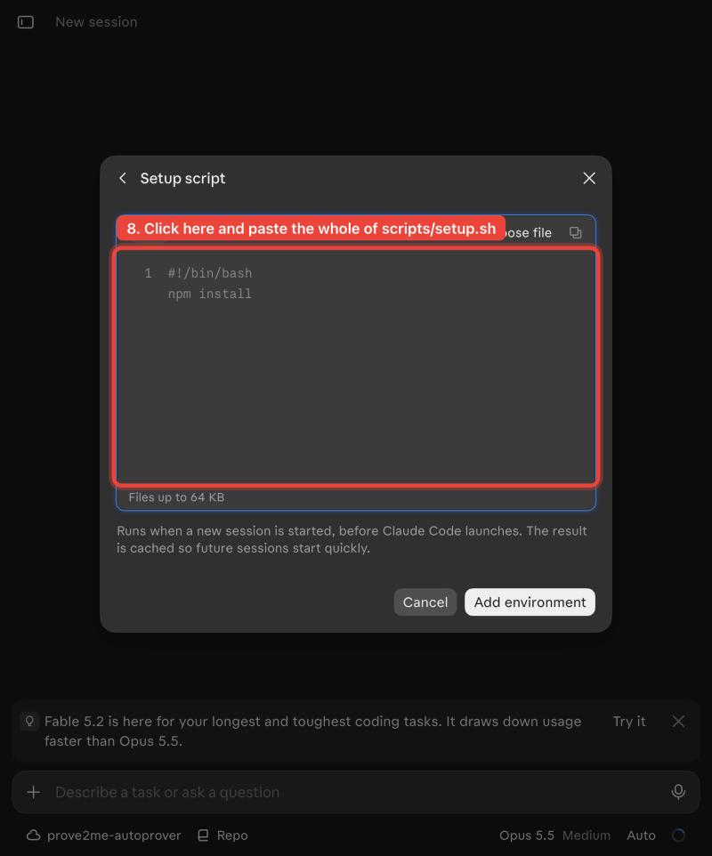
9. The editor should show about 104 lines starting with `#!/usr/bin/env bash`. Click the **back arrow**.
   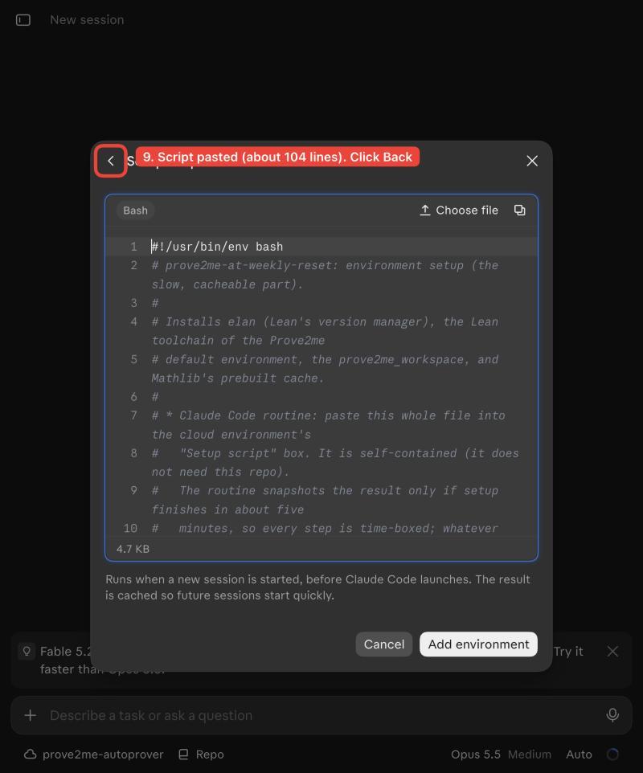
10. Click **Environment variables**.
    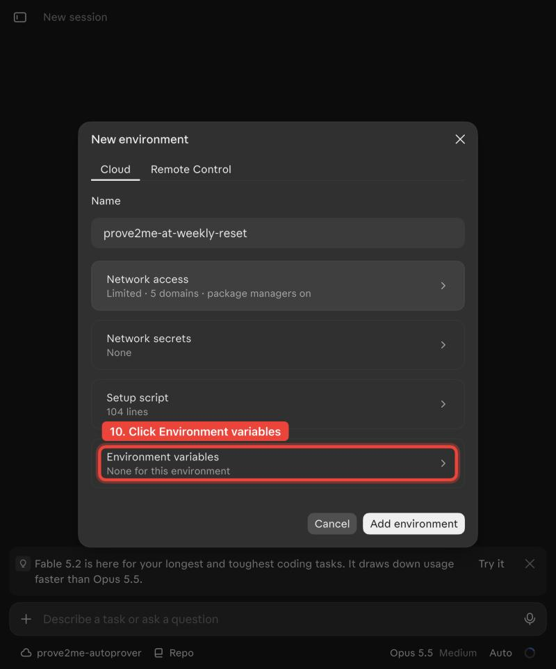
11. Paste the four lines below (add a fifth, `AUTOPROVER_ENCRYPTION_SECRET=...`, only if you chose the optional separate secret in SETUP.md step 4), replacing `p2m_...` with your own Prove2me key. The page warns "don't add secrets": that is expected here, which is why the environment must be **personal**, not shared with your organization.
    ```
    PROVE2ME_CREDENTIALS={"api_key":"p2m_..."}
    BASH_DEFAULT_TIMEOUT_MS=600000
    BASH_MAX_TIMEOUT_MS=1800000
    ENABLE_CLAUDEAI_MCP_SERVERS=false
    ```
    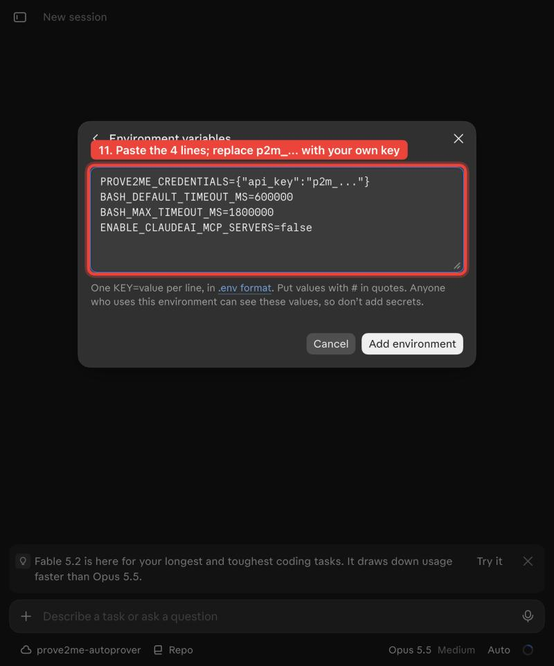
12. Click **Add environment**.
    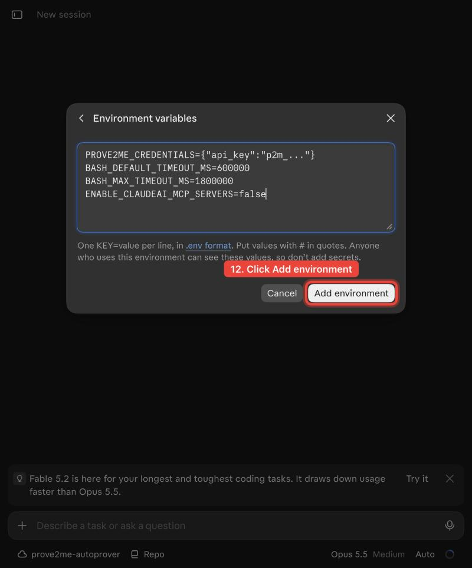

To check: open the environment button again, then **Cloud**. The new environment is listed under **Personal**.
